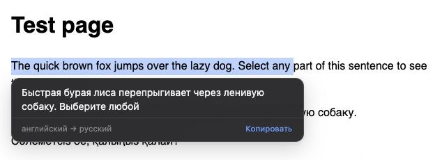

# Instant Translate

Browser extension for Safari and Chrome: select text on any page and a translation pops up right next to it. No buttons, no API keys.



## How it works

`content.js` catches the text selection and shows the popup. `background.js` sends the text to Google Translate, which auto-detects the language. If the text is already in your target language, it is translated into your second language instead. Both languages are set from the toolbar menu.

On YouTube, click any word in the subtitles: the video pauses and the translation pops up. You can also translate the whole subtitle line or hear the word pronounced. Hovering over the subtitles pauses the video too.

## Install in Safari

Needs Xcode. Sign in with your Apple ID in Xcode → Settings → Accounts to get a free signing certificate.

```bash
git clone https://github.com/naariman/instant-translate.git
cd instant-translate
./install.sh
```

Then enable it in Safari → Settings → Extensions and allow it on all websites.

## Install in Chrome

1. Download this repo (Code → Download ZIP) and unzip it.
2. Open `chrome://extensions` and turn on Developer mode.
3. Click "Load unpacked" and choose the `extension` folder.

Selected text is sent to Google Translate.

## License

MIT
